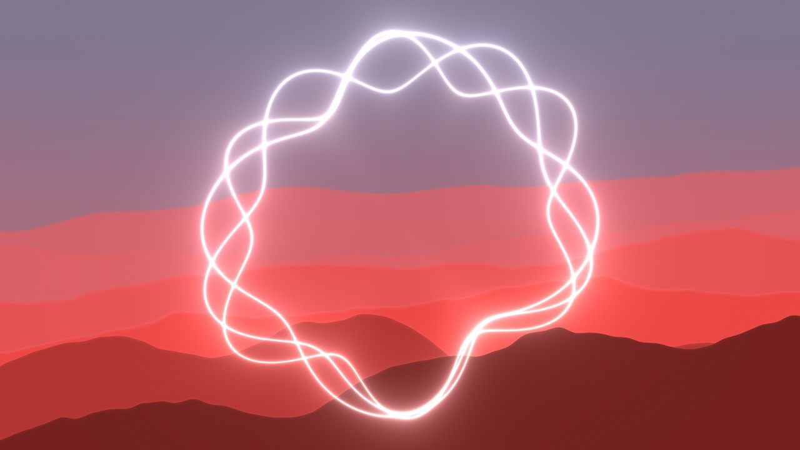

# RING VJ System

会場の音に反応して形を変える白い3本の輪を前景に固定し、その後ろの背景・配色・カメラ映像を切り替えて演出する、ブラウザで動くVJシステムです。Mac＋Chromeでのローカル利用を想定しています。

RING VJ System is a browser-based, audio-reactive VJ tool: three white rings respond to the microphone in front, while backgrounds, colour sets, camera filters and logos change behind them. Built with WebGL2 and TypeScript; runs locally on macOS with Chrome.



## 特徴

- **音で動く白い輪**：マイクの音を解析し、3本の輪が別々の波でほどけたり重なったりします。無音では1つの円に戻ります。全体・低音・中音・高音の感度を個別に調整できます。
- **切り替えられる背景**：霧、流紋、光の幕、群体、変形格子、結節、細胞、潮流、ドットの波、折り紙、山並み、光の屈折、にじむインクの13種類と、カメラ映像にフィルターをかけた2種類。
- **配色セット**：13の配色セットに加え、背景ごとに編集した色を記憶します。編集した色は「背景ごとの配色」として自動切替にも使えます。
- **自動切替**：背景・配色ごとに対象を選び、20／40／60秒で順に切り替えます。
- **カメラ**：顔の傾き・位置・向き、または肩の動きで背景を変形。カメラ映像をデュオトーン／ハーフトーンの背景として映したり、ライブ演者向けにどの背景にも薄く重ねたりできます。iPhoneは連係カメラとしてそのまま使えます。
- **ロゴ・動画**：画像や動画を輪の上に重ねます。名前を入力して透過ロゴを作ることもできます。素材はプロジェクト内のフォルダに置くだけで一覧に出て、次回も復元されます。
- **投影用の別窓**：合成後の映像だけを別ウィンドウに出し、拡張ディスプレイで全画面にできます。
- **すべて端末内で処理**：マイク・カメラの入力は解析のみで、録音・録画・外部送信はしません。依存の導入後はネットワーク不要で動きます。

## 動作環境

- macOS、Google Chrome（WebGL2対応）
- Node.js 22.18以上、npm
- マイク（会場音の入力用）。カメラ機能はWebカメラか、連係カメラとしてのiPhone

環境変数やAPIキーは不要です。

## はじめかた

```sh
npm ci
npm run dev
```

ターミナルに表示されるLocal URL（通常は `http://127.0.0.1:5173/`）をChromeで開きます。HTMLファイルを直接開くのではなく、ローカルサーバー経由で使います。終了は `Ctrl+C` です。

初回の `npm ci` 後、起動時にカメラ用の実行ファイルをローカルで準備します（導入済みのパッケージからコピーするだけで、ダウンロードはしません）。認識モデルは同梱済みです。

1. 中央プレビューの下の「背景を選ぶ」から背景を選びます。マイク未接続でも、1つの円と背景の動きを確認できます。
2. 「マイクを開始」で許可し、入力デバイスを選びます。音が入ると輪がほどけ始めます。
3. 「映像を別窓へ」で出力ウィンドウを開き、投影先のディスプレイへ移して「全画面にする」を押します。

## 使い方

### 背景と配色

- 背景と配色セットは、プレビュー下の横一列から選びます。左右に循環し、トラックパッド・スワイプ・左右ボタン・矢印キーで移動できます。
- 「背景」カードで、背景の明るさ（初期175%）・残像・歪み・速度を調整します。手動・自動で背景を替えてもこれらの値は保たれます。
- 右の「カラー」では、選択中の背景の背景色と3色を編集します。編集は背景ごとに自動保存されます。配色セットを選ぶと映像にはセットの色が優先され、「保存した配色を使う」で背景ごとの色へ戻せます。保存済みのカスタム配色は名前変更・削除ができ、既定の13セットは変更できません。
- 背景・配色のチェックで自動切替の対象を決めます。「自動切替」は初期オフで、20／40／60秒を選べます。「切替のなめらかさ」は即切替／0.6／1.5／3秒です。

背景そのものは音に反応せず、一定の基礎の動きで進みます。音への反応は白い輪が担います。

### 音

- 「動く線」カードで、全体（0.05〜20×）と低音・中音・高音（各0〜3×）の感度を調整します。全体の感度は「どこからを無音とみなすか」にも効き、下げるほど静かな場面で輪が円に戻りやすくなります。
- 「線の残像」（0〜100%）は、背景の残像とは別に輪の軌跡を残します。
- マイクの音はスピーカーへ再生しません。マイクが拒否された場合は、Chromeのサイト設定とmacOSの「プライバシーとセキュリティ → マイク」を確認してください。

### カメラ

右の「カメラ」タブで入力元を選び、「カメラを開始」で許可します。入力元は機器のIDと名前で記憶され、背景を切り替えても止まりません。「起動時にカメラを自動で開始」は詳細設定でオンにした場合だけ有効です。

- **背景が追う動き**：初期値は「顔」。首を傾けると背景が回転し、左右上下に動くと背景が移動し、横や上下を向くと遠近感が変わります。「肩・上半身」では両肩の傾きで背景が傾きます。白い輪は画面に固定されたままです。「今の顔を基準にする」で正面の姿勢を合わせ直せます。
- **カメラ背景**：「カメラ・デュオトーン」「カメラ・ハーフトーン」は、配色セットの色で着彩した映像を背景として映します。鏡像の切替ができます。
- **常時カメラ（ライブモード）**：「常時カメラON」にすると、どの背景の上にも薄くカメラ映像を重ねます（初期の濃さ25%）。演奏や歌のライブで、演者の姿を映像に残したいときに使います。
- カメラが動いていないときにカメラ背景が選ばれた場合は、代替の静かな面を表示して動作を続けます。

iPhoneを連係カメラとして使うには、MacとiPhoneを同じApple Accountで使い、Wi-FiとBluetoothを有効にして、iPhoneの「設定 → 一般 → AirPlayと連係」で連係カメラをオンにします。iPhoneを横向きでMacの近くに置くと、機器一覧に表示されます。[Appleの手順](https://support.apple.com/ja-jp/102546)

### ロゴ・動画

右の「ロゴ・動画」タブから重ねる素材を扱います。

- 「素材フォルダを開く」でプロジェクト内の `public/media/` が開きます。ここに画像・動画を置くと一覧に出て、クリックで「ロゴ・画像」または「重ねる動画」に入ります。一覧は3秒ごとに更新されます。
- サイズ・不透明度・回転（rpm）・合成方法（通常／スクリーン／加算）を調整できます。「音で大きさを変える」で音量に連動します。動画は無音でループし、再生速度を0.25〜4倍で変えられます。
- 白黒素材は「抜く範囲」と「境界ぼかし」で透過できます。
- フォルダから選んだ素材は、ファイル名と表示設定を記憶して次回も復元します。その場限りの素材は「画像を選ぶ」「動画を選ぶ」から読み込めます（こちらは保存しません）。
- ロゴがない場合は「文字からロゴを作る」で、名前から円形・六角形・上下ライン・文字のみの透過ロゴを作れます。字体と色を選び、「透過PNGを保存」で書き出せます。

対応形式は、画像がPNG・JPEG・WebP・GIF・SVG、動画がMP4・M4V・WebM（MOVは非対応）、1ファイル200MBまでです。`public/media/` の中身はGitの追跡対象外で、READMEと `.gitkeep` だけを残しています。[素材フォルダの説明](public/media/README.md)

合成の順番は、背景 → 白い輪 → 動画 → ロゴです。素材は背景の残像に含めないので、ロゴは常にはっきり読めます。

### 投影する

「映像を別窓へ」で合成後の映像だけを別ウィンドウに開きます。Macのディスプレイを拡張表示にし、出力窓を投影先へ移動して「全画面にする」を押してください。ポップアップが拒否された場合は、このローカルサイトのポップアップを許可します。

- 出力窓内のマウスカーソルは常に非表示です。マウスを動かすと操作バーが現れ、Fキーでも全画面を切り替えられます。
- 画質は「共通の出力」で、標準 1600×900／高画質 1920×1080／軽量 1280×720 を選べます。大きなディスプレイでは高画質を推奨します。異なる比率の画面では黒い余白が付きます。
- 出力窓は60fpsで取得を要求しますが、実際の速さは描画負荷と出力先の表示に依存します。画面右上に実際のfpsを表示します。負荷が高いときは画質を「軽量」にしてください。
- 「出力の明るさ」と「暗転」はロゴと動画にも効きます。「一時停止」は映像の動きと音反応を止め、停止中も表現と色は変更できます。
- 操作側のタブを閉じたり最小化したりすると、ブラウザの制御で出力が止まったり遅くなったりすることがあります。投影中は操作側も表示したままにしてください。

| キー | 操作 |
|---|---|
| Space | 映像の一時停止・再開 |
| H | 操作画面の表示・非表示 |
| F | 全画面の開始・終了 |
| B | 暗転・解除 |
| → | チェックした対象の中で次の背景へ |
| Escape | 操作画面を表示し、暗転を解除 |

スライダーや選択欄の操作中は、キー操作よりその入力を優先します。

## プライバシーと安全

- マイクの音とカメラの映像は端末内で解析します。録音・録画・保存・外部送信はしません。
- カメラ映像が出力されるのは、カメラ背景か「常時カメラON」を選んだときだけです。その他の背景ではカメラ映像は操作画面内の確認用です。
- 顔・姿勢の認識モデル（MediaPipe）は同梱済みで、実行時にCDNへ接続しません。
- 素材フォルダを開く・一覧する入口は、ローカルサーバー（`npm run dev` / `npm run preview`）がlocalhostからの要求にだけ応えます。

## ビルドして使う

```sh
npm run check
npm run build
npm run preview
```

`npm run check` は型チェック、`npm run build` は型チェックと配信用ファイルの生成、`npm run preview` はビルド結果をローカルで起動します。表示されたLocal URLをChromeで開いてください。素材フォルダを使う場合も、このローカルサーバー経由で起動します。

## 関連プロジェクトと使用ライブラリ

- 作者の過去作 [greenVJ](https://github.com/enhiro971021/greenVJ) の表現や音声処理の考え方を引き継ぎ、ブラウザ向けに開発しています。
- 顔・姿勢の認識には [MediaPipe](https://developers.google.com/mediapipe) のモデルと実行ファイルを同梱しています。[出典とライセンス](public/mediapipe/README.md)

## ライセンス

本プロジェクトのライセンスは未設定です。

同梱するMediaPipeのモデルと実行ファイルにはApache-2.0が適用されます。詳しくは[出典とライセンス](public/mediapipe/README.md)を参照してください。その他の依存パッケージには、それぞれのライセンスが適用されます。
